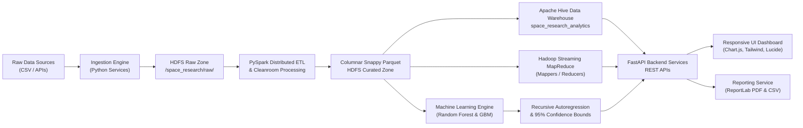

# Space Research Data Analytics: A Hadoop Ecosystem Approach to Demand Forecasting

An enterprise-grade Big Data Analytics platform engineering large-scale space research datasets, orchestrating distributed Hadoop ecosystem processing (HDFS, Hive, MapReduce, PySpark), and providing machine learning-powered predictive demand forecasting.

---

## 1. Executive Summary & Architecture

The **Space Research Big Data Analytics Platform** captures and synthesizes multi-dimensional aerospace data across 10 mission-critical domains:
1. Satellite orbital parameters & constellations (LEO, MEO, GEO, Deep Space).
2. Global space missions, payloads, and programmatic budgets.
3. Rocket launch vehicle activities, insertion outcomes, and commercial vs. civil flight splits.
4. Space agency research & operational expenditures (2010–2026).
5. Satellite manufacturing specifications and delivery timelines.
6. Space equipment and precision component demand.
7. Space agency research activities.
8. Space infrastructure utilization (Deep Space Network, thermal vacuum chambers).
9. Critical resource consumption (LOX, RP-1, LH2, telemetry bandwidth, solar arrays).
10. Future exploration roadmap investments (Artemis, Mars Sample Return, Gateway).

### End-to-End Big Data Architecture


---

## 2. Hadoop Ecosystem Implementation

### 2.1 HDFS Storage Architecture
Data is organized into enterprise lakehouse tiers under `/space_research/`:
* `/space_research/raw/`: Original ingested CSV datasets.
* `/space_research/processed/`: Standardized, deduplicated, and null-imputed records.
* `/space_research/curated/`: Optimized columnar **Apache Parquet** partitioned by `year` and `launch_year`.
* `/space_research/analytics/`: MapReduce job outputs and aggregated TSV/JSON summaries.
* `/space_research/forecasting/`: Recursive prediction matrices and feature vectors.
* `/space_research/reports/`: Generated PDF whitepapers and audit CSV exports.

### 2.2 Apache Hive Data Warehouse
* **Database**: `space_research_analytics`
* **Tables**:
  - `space_missions` (Partitioned by `year`)
  - `satellites_orbital` (Partitioned by `launch_year`)
  - `launch_activities` (Partitioned by `year`, `month`)
  - `equipment_component_demand` (Partitioned by `year`, `month`)
  - `agency_research_expenditures` (Partitioned by `year`, `month`)
  - `resource_consumption` (Partitioned by `year`, `month`)

Hive queries are located in [analytical_queries.sql](file:///e:/PROJECTS/BDT/hadoop_ecosystem/hive/queries/analytical_queries.sql) and can be executed interactively via the dashboard console or Hive CLI.

### 2.3 Hadoop Streaming MapReduce
* **Mission Aggregation Job**:
  - Mapper: [mapper_missions.py](file:///e:/PROJECTS/BDT/hadoop_ecosystem/mapreduce/mappers/mapper_missions.py)
  - Reducer: [reducer_missions.py](file:///e:/PROJECTS/BDT/hadoop_ecosystem/mapreduce/reducers/reducer_missions.py)
  - Streaming Command:
    ```bash
    hadoop jar hadoop-streaming.jar \
      -files mapper_missions.py,reducer_missions.py \
      -mapper mapper_missions.py \
      -reducer reducer_missions.py \
      -input /space_research/raw/space_missions.csv \
      -output /space_research/analytics/mr_missions
    ```
* **Equipment Demand Job**:
  - Mapper: [mapper_demand.py](file:///e:/PROJECTS/BDT/hadoop_ecosystem/mapreduce/mappers/mapper_demand.py)
  - Reducer: [reducer_demand.py](file:///e:/PROJECTS/BDT/hadoop_ecosystem/mapreduce/reducers/reducer_demand.py)

### 2.4 Apache Spark / PySpark ETL Pipeline
Located in [spark_etl_pipeline.py](file:///e:/PROJECTS/BDT/hadoop_ecosystem/spark/jobs/spark_etl_pipeline.py), the pipeline performs:
- Schema enforcement and type casting.
- Null value imputation using domain medians.
- Outlier filtering and duplicate removal.
- Columnar Parquet conversion with snappy compression and year-based partitioning.

---

## 3. Demand Forecasting Engine

The platform incorporates a machine learning forecasting engine:
- **Algorithms**: Random Forest Regressor and Gradient Boosting Regressor (GBM).
- **Validation**: Strict chronological train-test split (85% train, 15% out-of-sample backtesting) to ensure zero data leakage.
- **Evaluation Metrics**:
  - Mean Absolute Error (MAE)
  - Root Mean Squared Error (RMSE)
  - Coefficient of Determination ($R^2$)
  - Mean Absolute Percentage Error (MAPE)
  - Historical Backtested Accuracy ($100\% - \text{MAPE}$)
- **Horizon Configuration**: Dynamic multi-step recursive forecasting across 3, 6, 12, and 36 months.
- **Confidence Intervals**: 95% dynamic confidence envelopes scaling with forecast horizon ($z \cdot \sigma \cdot \sqrt{h}$).
- **Automated Insights**: Dynamic natural language generation converting statistical outputs into decision support narratives.

---

## 4. REST API Endpoints

The FastAPI backend exposes modular REST endpoints:

| Endpoint | Method | Description |
| :--- | :---: | :--- |
| `/api/overview/kpis` | `GET` | Core mission, satellite, and Big Data processing metrics |
| `/api/analytics/agency-missions` | `GET` | Space agency budget, mission volume, and success rates |
| `/api/analytics/launch-trends` | `GET` | Yearly launch frequency, outcomes, and vehicle stats |
| `/api/analytics/resource-consumption` | `GET` | Consumed propellants, telemetry, and power metrics |
| `/api/analytics/insights` | `GET` | Dynamically generated natural language findings |
| `/api/hdfs/overview` | `GET` | Storage size, file counts, and simulated HDFS blocks |
| `/api/hdfs/zone-files` | `GET` | Detailed file listings per HDFS zone |
| `/api/hive/tables` | `GET` | Hive database metastore schemas and locations |
| `/api/hive/query` | `GET` | Interactive execution of Hive SQL analytical queries |
| `/api/mapreduce/run` | `POST` | On-demand execution of MapReduce streaming jobs |
| `/api/forecasting/predict` | `GET` | Predictive demand forecast with confidence intervals |
| `/api/reports/download/pdf` | `GET` | Download executive ReportLab PDF whitepaper |
| `/api/reports/download/csv` | `GET` | Export forecasting projections table as CSV |

---

## 5. Setup & Execution Instructions

### Prerequisites
- Python 3.10+ (tested with Python 3.14)
- Web Browser (Chrome, Firefox, Edge)
- Optional: Docker & Docker Compose for standalone multi-node Hadoop cluster.

### Running the Platform
1. **Activate Environment & Start Backend Server**:
   ```powershell
   cd E:\PROJECTS\BDT
   $env:PYTHONPATH = "E:\PROJECTS\BDT\backend"
   python -m uvicorn app.main:app --host 127.0.0.1 --port 8000
   ```
2. **Access the Web Dashboard**:
   Open your browser and navigate to:
   [http://127.0.0.1:8000/](http://127.0.0.1:8000/)

   The FastAPI server serves both the REST API and the responsive single-page analytics application.

3. **Running PySpark / Parquet ETL Standalone**:
   ```powershell
   python hadoop_ecosystem\spark\jobs\spark_etl_pipeline.py
   ```

4. **Running Hadoop Streaming via Docker (Optional Distributed Deployment)**:
   ```bash
   cd hadoop_ecosystem
   docker-compose up -d
   ```

