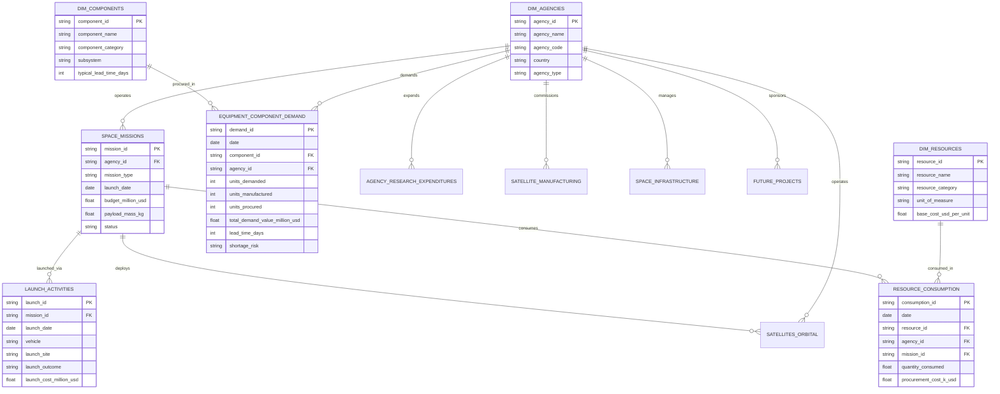

# Orbitalytics Phase 1: Canonical Data Model & Star Schema Architecture

## 1. Overview
Phase 1 establishes a canonical relational data model designed for seamless distributed processing in the Hadoop ecosystem. The logical model defines:
- **Reference Dimensions:** Master entities for agencies, components, resources, and time.
- **Transactional Entities:** Mission manifests, satellite telemetry records, and launch logs.
- **Analytical Fact Tables:** Discrete component demand observations, resource consumption metrics, and agency expenditures.

---

## 2. Entity-Relationship Diagram (ERD)

---

## 3. Logical Star-Schema Proposal for Apache Hive Data Warehousing
To prepare for distributed analytical queries (Apache Hive and PySpark SQL in subsequent phases), the relational model maps directly into a star-schema data warehouse:

### Dimension Tables:
1. **`dim_agencies`:** `agency_id` (PK), `agency_name`, `agency_code`, `country`, `agency_type`.
2. **`dim_components`:** `component_id` (PK), `component_name`, `component_category`, `subsystem`, `criticality_tier`.
3. **`dim_resources`:** `resource_id` (PK), `resource_name`, `resource_category`, `unit_of_measure`.
4. **`dim_time`:** `date` (PK), `year`, `quarter`, `month`, `month_name`, `day_of_year`, `is_weekend`.
5. **`dim_orbits`:** `orbit_code` (PK), `orbit_name`, `altitude_regime`, `typical_mission_types`.

### Fact Tables:
1. **`fact_equipment_demand`:**
   - Keys: `demand_id` (PK), `date` (FK), `component_id` (FK), `agency_id` (FK)
   - Metrics: `units_demanded`, `units_manufactured`, `units_procured`, `avg_unit_cost_thousand_usd`, `total_demand_value_million_usd`, `lead_time_days`.
   - Partitioning Strategy: Partitioned by `year` and `component_category`.
2. **`fact_resource_consumption`:**
   - Keys: `consumption_id` (PK), `date` (FK), `resource_id` (FK), `agency_id` (FK), `mission_id` (FK)
   - Metrics: `quantity_consumed`, `procurement_cost_k_usd`.
   - Partitioning Strategy: Partitioned by `year` and `resource_category`.
3. **`fact_space_missions`:**
   - Keys: `mission_id` (PK), `agency_id` (FK), `launch_date` (FK)
   - Metrics: `budget_million_usd`, `payload_mass_kg`, `duration_days`, `crew_size`.
   - Partitioning Strategy: Partitioned by `agency` and `year`.

