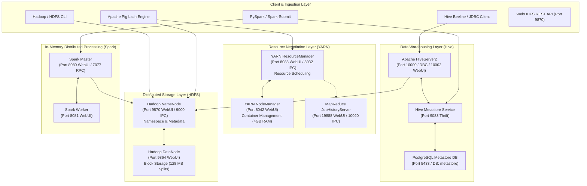

# Orbitalytics Phase 2: Hadoop Ecosystem Environment Architecture

## 1. Architectural Vision
Phase 2 establishes a fully containerized, production-aligned Big Data architecture capable of distributed storage (HDFS), resource negotiation (YARN), batch processing (Hadoop MapReduce), structured data warehousing (Apache Hive with persistent PostgreSQL metastore), client scripting (Apache Pig), and in-memory analytics & machine learning (Apache Spark / PySpark).

Because development occurs on Windows workstations, the infrastructure is orchestrated via **Docker Compose running on WSL2 Linux Kernel 6.6**. This ensures strict Linux compatibility, zero path-separator corruption, and bitwise parity with enterprise multi-node cloud clusters (AWS EMR / Google Cloud Dataproc / Azure HDInsight).

---

## 2. Distributed Service Architecture Diagram

---

## 3. Container Services Breakdown

| Service Name | Container Name | Base Docker Image | Network Ports Exposed | Memory Limit | Health Check Specification |
| :--- | :--- | :--- | :--- | :---: | :--- |
| **NameNode** | `hadoop-namenode` | `bde2020/hadoop-namenode:2.0.0-hadoop3.2.1-java8` | `9870` (HTTP), `9000` (IPC) | 1,024 MB | `curl -f http://localhost:9870/dfshealth.html` |
| **DataNode** | `hadoop-datanode` | `bde2020/hadoop-datanode:2.0.0-hadoop3.2.1-java8` | `9864` (HTTP) | 1,024 MB | `curl -f http://localhost:9864/` |
| **ResourceManager** | `hadoop-resourcemanager` | `bde2020/hadoop-resourcemanager:2.0.0-hadoop3.2.1-java8` | `8088` (HTTP) | 1,024 MB | `curl -f http://localhost:8088/cluster` |
| **NodeManager** | `hadoop-nodemanager` | `bde2020/hadoop-nodemanager:2.0.0-hadoop3.2.1-java8` | `8042` (HTTP) | 2,048 MB | `curl -f http://localhost:8042/node` |
| **JobHistoryServer**| `hadoop-historyserver` | `bde2020/hadoop-historyserver:2.0.0-hadoop3.2.1-java8` | `19888` (HTTP), `10020` (IPC) | 512 MB | Process heartbeat on timeline store |
| **Metastore Database**| `hive-metastore-postgresql`| `bde2020/hive-metastore-postgresql:2.3.0` | `5433` (PostgreSQL) | 512 MB | `pg_isready -U hive -d metastore` |
| **HiveServer2** | `hive-server` | `bde2020/hive:2.3.2-postgresql-metastore` | `10000` (JDBC), `10002` (WebUI) | 1,536 MB | Thrift handshake on port 10000 |
| **Spark Master** | `spark-master` | `bde2020/spark-master:3.1.2-hadoop3.2` | `8080` (WebUI), `7077` (RPC) | 1,024 MB | `curl -f http://localhost:8080/` |
| **Spark Worker** | `spark-worker` | `bde2020/spark-worker:3.1.2-hadoop3.2` | `8081` (WebUI) | 1,536 MB | `curl -f http://localhost:8081/` |

---

## 4. Persistent Storage & Volume Geometry
Container state is preserved across restarts via dedicated Docker named volumes:
1. `hadoop_namenode`: Persists the HDFS File System Image (`fsimage`) and edit logs (`edits`).
2. `hadoop_datanode`: Stores physical 128 MB HDFS block replicas and block metadata.
3. `hadoop_historyserver`: Retains MapReduce job counters, stage metrics, and execution logs.
4. `hive_metastore_db`: Persists the relational database catalog (table definitions, schema types, partitions).

---

## 5. Security & Multi-Tenant Network
All containers join a dedicated bridge network (`hadoop_ecosystem_default`), enabling DNS resolution across hostnames (`namenode`, `datanode`, `resourcemanager`, `hive-server`, `spark-master`).
Security permissions are set to open development mode (`dfs.permissions.enabled = false`) to facilitate automated pipeline ingestion without privilege escalation hurdles.

