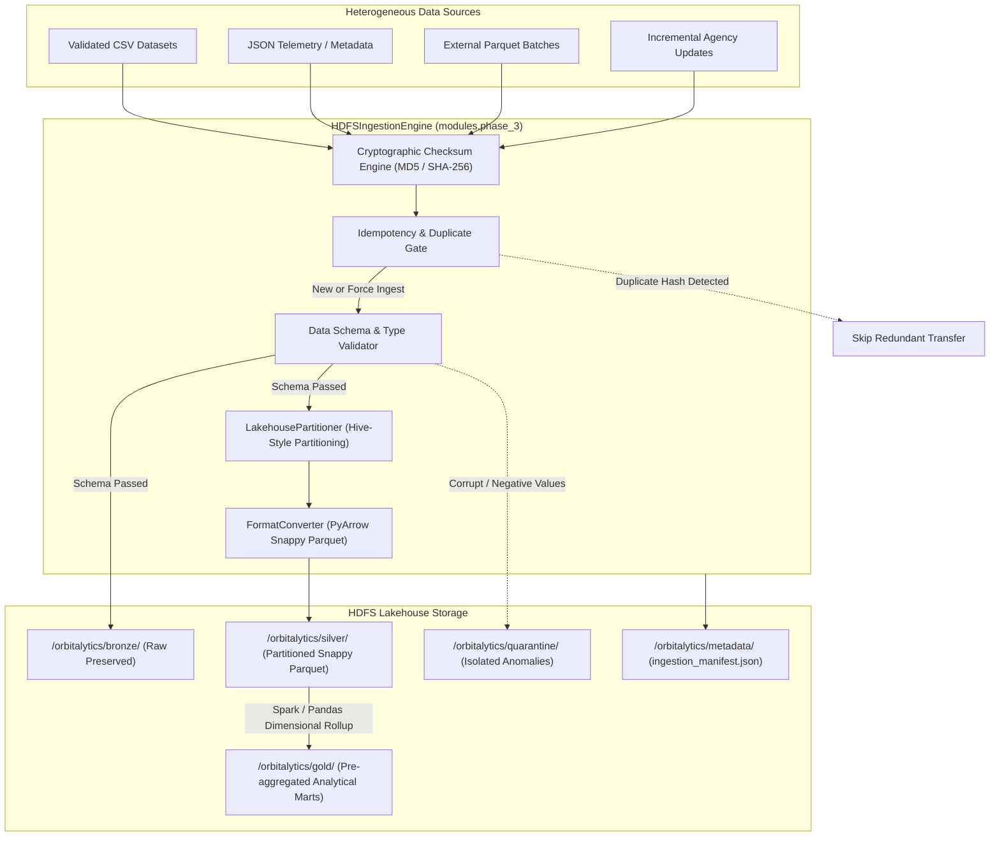

# ORBITALYTICS — PHASE 3: DATA INGESTION FRAMEWORK
## Modular Architecture, Multi-Format Pipelines, Idempotency, and Quarantine Processing

```
Document Version: 1.0.0
Author: Principal Data Lake Architect & Big Data DevOps Engineer
Project: ORBITALYTICS (Space Research Data Analytics: A Hadoop Ecosystem Approach to Demand Forecasting)
Framework Namespace: modules.phase_3.hdfs_ingestion_engine
```

---

## 1. Architectural Overview & Component Structure

The Orbitalytics Data Ingestion Framework provides an enterprise-grade, modular pipeline designed to reliably transfer heterogeneous space research datasets into the Apache Hadoop HDFS Data Lakehouse.



---

## 2. Ingestion Framework Components

### 2.1. `HDFSClient` (`modules/phase_3/hdfs_client.py`)
Acts as the production interface directly to the Apache Hadoop NameNode container (`hadoop-namenode`). Implements resilient file staging and execution:
- `put_file(local_path, hdfs_path)`: Streams local files into HDFS via container staging and cleans up scratch files.
- `put_bytes(data_bytes, filename, hdfs_dir)`: Allows in-memory Parquet and CSV byte streams to be directly committed to HDFS.
- `ls(hdfs_path, recursive)`: Parses distributed filesystem metadata (permissions, owner, size, timestamp).
- `checksum(hdfs_path)`: Generates MD5 checksums directly over distributed HDFS blocks via `hdfs dfs -cat | md5sum` to ensure network transfer fidelity.

### 2.2. `LakehousePartitioner` (`modules/phase_3/partitioner.py`)
Applies domain-informed directory partitioning:
- Avoids over-partitioning and the small-file problem through the `MIN_PARTITION_RECORDS = 5` threshold.
- Automatically handles Hive-style directory paths (`year=YYYY/part-00000.parquet` or `component_category=CAT/part-00000.parquet`).

### 2.3. `FormatConverter` (`modules/phase_3/format_converter.py`)
Leverages Apache Arrow (`pyarrow`) for high-throughput columnar serialization:
- Enforces strict data types, UTF-8 strings, ISO 8601 dates, and 64-bit IEEE floats.
- Compresses with `snappy` codec to balance decompression speed with storage density.

### 2.4. `IngestionManifest` (`modules/phase_3/ingestion_manifest.py`)
Maintains an immutable ledger of every ingestion transaction:
- Assigns unique transaction UUIDs: `ING-XXXXXXXXXXXX`.
- Records raw file sizes, MD5/SHA-256 hashes, source provenance, row counts, partition counts, and processing verdicts.
- Serialized to `datasets/metadata/ingestion_manifest.json` and mirrored in HDFS at `/orbitalytics/metadata/ingestion_manifest.json`.

---

## 3. Bulk vs. Incremental Ingestion Strategy

| Feature | Initial Bulk Ingestion | Repeatable Incremental Ingestion |
| :--- | :--- | :--- |
| **Trigger Mechanism** | Cluster initialization or historical backfill | Scheduled API ingest or agency file arrival |
| **Idempotency Control** | Overwrites or initializes lakehouse structure | Computes cryptographic hash before staging |
| **Duplicate Prevention** | Enforced via dataset inventory check | Rejects identical hash; version-tags schema evolution |
| **HDFS Commit Mode** | Atomic directory creation and batch upload | Atomic partition append (`part-XXXXX.parquet`) |
| **Manifest Action** | Registers baseline `ING-` transactions | Appends incremental delta audit records |

---

## 4. Quarantine & Failure Recovery Workflow

To guarantee that corrupt data cannot propagate downstream into Silver or Gold analytical tiers, the ingestion engine incorporates an isolated quarantine mechanism:

1. **Validation Filter:** During ingestion, incoming records are checked against domain integrity constraints (e.g. positive budget, non-negative demanded units, valid ISO 8601 date format).
2. **Anomaly Isolation:** When records fail integrity rules, they are separated from the main batch and routed directly to:  
   `hdfs://namenode:9000/orbitalytics/quarantine/{dataset}_quarantined_{timestamp}.csv`
3. **Quarantine Audit Payload:** Quarantined rows carry diagnostic metadata columns:
   - `rejection_reason`: Explicit rule violation (e.g., `NEGATIVE_UNITS_AND_CORRUPT_DATE`).
   - `quarantine_timestamp`: UTC timestamp of isolation.
   - `source_filename`: Originating file.
4. **Alerting & Recovery:** Quarantined records trigger an entry in the ingestion manifest with `validation_status: QUARANTINED`. Data engineers can review, remediate, and re-ingest the quarantined delta without re-processing the main batch.

