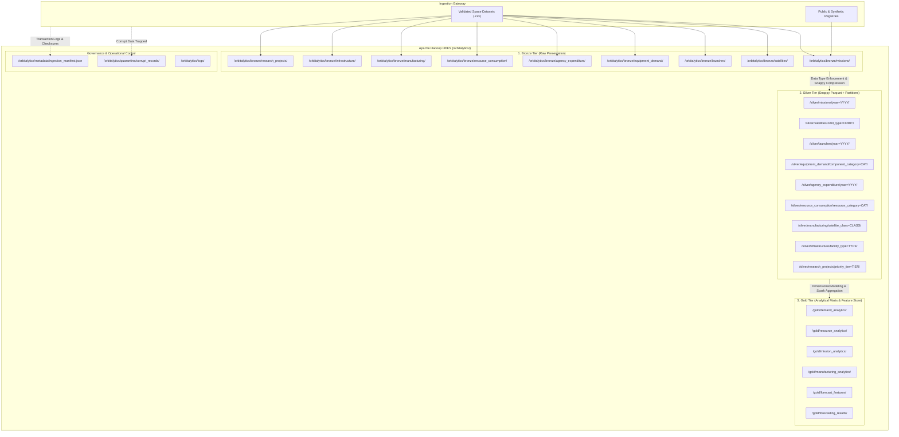

# ORBITALYTICS — PHASE 3: HDFS DATA LAKEHOUSE ARCHITECTURE
## Distributed Storage Design, Medallion Hierarchy, and Lakehouse Topology

```
Document Version: 1.0.0
Author: Principal Data Lake Architect & Big Data DevOps Engineer
Project: ORBITALYTICS (Space Research Data Analytics: A Hadoop Ecosystem Approach to Demand Forecasting)
Target Cluster: Apache Hadoop 3.2.1 / HDFS 3.2.1 Distributed Lakehouse
HDFS Lakehouse Root: hdfs://namenode:9000/orbitalytics/
```

---

## 1. Executive Summary & Storage Philosophy

Phase 3 transitions the validated aerospace datasets from Phase 1 into a production-grade distributed **Medallion Lakehouse Architecture** deployed on the live Apache Hadoop HDFS cluster configured in Phase 2. 

The storage architecture adheres to the following foundational principles:
1. **Raw Immutability (Bronze):** Raw, source-faithful data is preserved verbatim without destructive mutations, serving as the immutable audit trail and historical disaster recovery base.
2. **Schema-Enforced Columnar Storage (Silver):** Validated, cleansed, and typed records are converted into **Snappy-compressed Apache Parquet** files, organized into domain-driven Hive-style partitions to maximize analytical scan efficiency and minimize I/O overhead.
3. **Aggregated Analytical Marts (Gold):** Highly curated, pre-aggregated dimensional models and ML-ready feature stores are materialized as columnar Parquet files, optimized for downstream querying by Apache Hive, Apache Spark, and the FastAPI application layer.
4. **Governance, Auditing & Isolation (Metadata, Quarantine, Logs):** Every transaction is tracked via cryptographic checksums (MD5 and SHA-256), with non-compliant records quarantined to prevent lakehouse contamination.

---

## 2. Distributed Lakehouse Topology & Directory Structure



---

## 3. Tiered Storage Specifications

| Lakehouse Tier | HDFS Directory Path | Storage Format | Compression | Replication | Target Audience & Use Case |
| :--- | :--- | :--- | :--- | :---: | :--- |
| **Bronze** | `/orbitalytics/bronze/{domain}/` | Raw CSV / JSON | Uncompressed | 1 (Dev) / 3 (Prod) | Forensic audit, historical provenance, raw re-processing. |
| **Silver** | `/orbitalytics/silver/{domain}/` | Apache Parquet | Snappy | 1 (Dev) / 3 (Prod) | Hive SQL warehousing, Spark DataFrame analytics, ETL pipelines. |
| **Gold** | `/orbitalytics/gold/{mart}/` | Apache Parquet | Snappy | 1 (Dev) / 3 (Prod) | Business intelligence, ML time-series forecasting, executive reporting. |
| **Metadata** | `/orbitalytics/metadata/` | JSON | None | 1 (Dev) / 3 (Prod) | Ingestion manifests, schema registries, cryptographic checksums. |
| **Quarantine** | `/orbitalytics/quarantine/` | Raw CSV | None | 1 (Dev) / 3 (Prod) | Quarantined anomaly records rejected during ingestion checks. |
| **Logs** | `/orbitalytics/logs/` | Text Log | None | 1 (Dev) / 3 (Prod) | Ingestion audit trails, pipeline orchestrator diagnostics. |

---

## 4. HDFS Physical Configuration Parameters

The Lakehouse operates on Apache Hadoop HDFS configured through `/etc/hadoop/hdfs-site.xml` and `/etc/hadoop/core-site.xml`:

1. **Default Block Size (`dfs.blocksize`):**  
   Configured to **134,217,728 bytes (128 MB)**. This ensures that large batch MapReduce splits and Spark partition tasks process sufficient data volume per vcore, eliminating NameNode metadata overhead caused by excessive tiny blocks.
2. **Replication Factor (`dfs.replication`):**  
   Configured to **1** in the current single-DataNode development cluster (`hadoop-datanode`). In a multi-node production deployment, this parameter scales to **3** across rack-aware fault domains.
3. **DataNode Storage Path:**  
   Mounted to persistent Docker volume `hadoop_datanode_data:/hadoop/dfs/data` on the host machine.
4. **NameNode Metadata Path:**  
   Mounted to persistent Docker volume `hadoop_namenode_data:/hadoop/dfs/name` on the host machine.
5. **Client Access URI:**  
   `hdfs://namenode:9000` (internal Docker bridge network `hadoop-ecosystem_hadoop_network`) and mapped to host port `9000` for client utilities.

---

## 5. Security, Permissions, and Access Control

- **Superuser Group:** `supergroup`
- **Lakehouse Root Permissions:** `drwxr-xr-x` (755) — owned by `root:supergroup`.
- **Bronze Tier Permissions:** `drwxr-xr-x` (755) — write-restricted to the ingestion service account.
- **Silver & Gold Tier Permissions:** `drwxr-xr-x` (755) — accessible by Apache Hive (`hive`) and Apache Spark (`spark`) execution contexts.
- **Quarantine Permissions:** `drwx------` (700) — restricted exclusively to Data Governance and Data Quality engineers.

